In this short guide, we'll set up Grafana locally to display your Mac's metrics such as CPU usage, network traffic, and disk space usage. All you need to follow along is a **Mac** and **Homebrew**, which you should already have installed.

At the end, you'll end up with a dashboard like this:

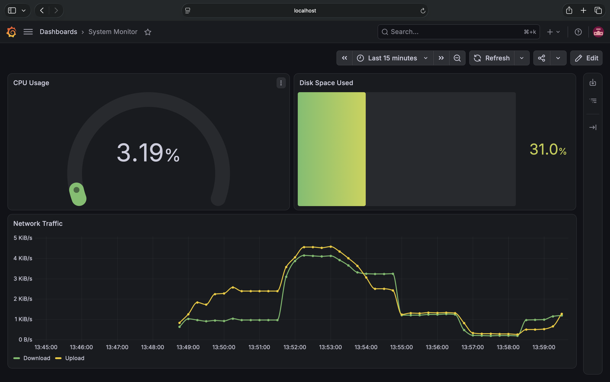

We'll be using three tools - [Node Exporter](https://github.com/prometheus/node_exporter), [Prometheus](https://prometheus.io), and [Grafana](https://grafana.com). This is the big picture:

- We'll run Node Exporter on our Mac, which monitors and exposes our Mac's metrics
- We'll use Prometheus to collect and store those exposed metrics
- We'll use Grafana to build a dashboard displaying the metrics

Everything will run locally, so no API keys needed.

## Grafana

So what is Grafana? Grafana is a tool that turns numbers and metrics into visual dashboards. It comes with built-in visualization types, so you don't need to build charts from scratch.

You create dashboards by:

- Selecting a visualization (time series, bar chart, gauge...)
- Connecting a data source
- Configuring the fields you want to display

Grafana also supports plugins that add more visualization types and capabilities, as well as allowing you to import dashboards created by other people. You can spend days on tailoring your dashboard to your artistic liking. However, today we'll focus on the basics and getting started as quickly as possible.

### Installation

There are [three main options](https://grafana.com/docs/grafana/latest/setup-grafana/installation/mac/) to install Grafana locally on your Mac:

- Using Homebrew
- Using Docker and Docker Compose
- Manual binary download

We'll be using Homebrew as it's the easiest option and doesn't require Docker.

In your terminal first update `brew` and then install Grafana:

```sh
brew update
brew install grafana
```

This downloads and untars the files into `/opt/homebrew/Cellar/grafana/[version]` (or `/usr/local/...` on Intel Macs).

To start Grafana, run:

```sh
brew services start grafana
```

`brew services` is a Homebrew command that manages background services on your Mac (via macOS `launchd`). It lets you start, stop, restart, and automatically launch tools such as Grafana. It's a convenient way to manage programs that should run in the background without you having to open a terminal and start them manually each time. By running the command above, Homebrew starts Grafana and configures macOS to launch it automatically when you log in.

If you now go to http://localhost:3000/login, you should see Grafana's login page.

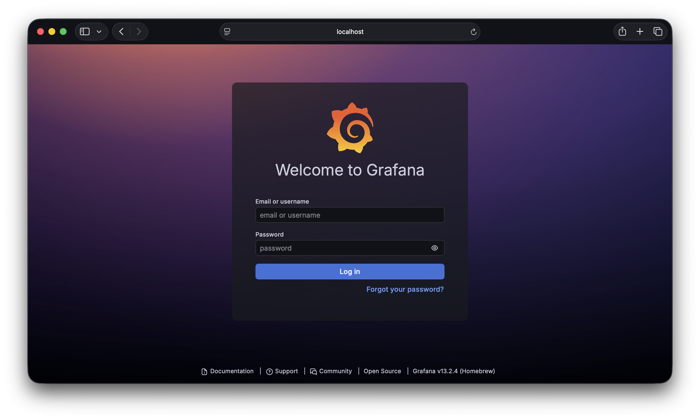

When signing in for the first time use `admin` for both the username and password. You'll then be asked to create a new password.

Congrats, you're now running Grafana locally on your Mac.

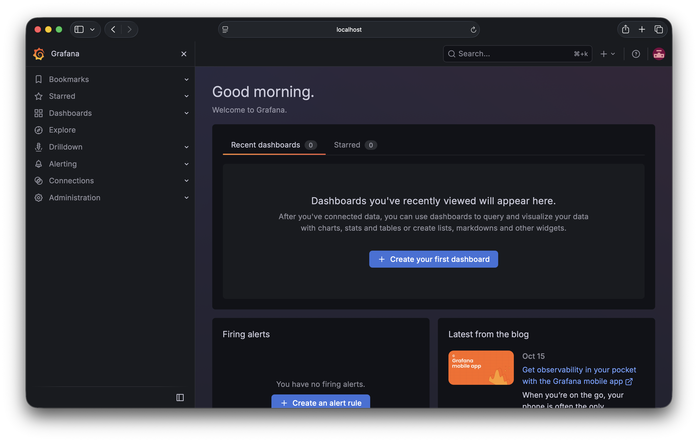

This is where we'll create our dashboard.

As mentioned earlier, we'll be monitoring our laptop's metrics such as CPU usage and network traffic. To collect these metrics, we'll use Prometheus.

## Prometheus

To display data, we first need to collect that data. That's what Prometheus is for - it is a monitoring system that collects, stores, and lets you query measurements from computers, servers, and applications over time.

We want to monitor our Mac's CPU usage, disk space and network traffic. Prometheus can collect these measurements every 15 seconds and store them so you can inspect what happened earlier.

In a nutshell, Prometheus allows you to:

- Collect metrics (periodically requests metrics from sources that expose data)
- Store historical data (it saves timestamped measurements)
- Query the data (Prometheus has its own query language called _PromQL_)

But in order for Prometheus to collect the data, we first need something that exposes our Mac's metrics for Prometheus to scrape. In Prometheus terms, this is called an _exporter_ (or a _target_).

### Installing Node Exporter

Node Exporter is a small program that exposes measurements about your machine, such as:

- CPU activity
- Memory and disk usage
- Disk read/write activity
- Network traffic

It makes these metrics available over HTTP on port `9100`.

Open Terminal and run:

```sh
brew install node_exporter
```

Let's use `brew services` to start it automatically (just like we did with Grafana):

```sh
brew services start node_exporter
```

This starts Node Exporter and configures it to start when you log in to your Mac.

To verify that it's collecting metrics:

```sh
curl http://localhost:9100/metrics
```

Or you can open http://localhost:9100/metrics in your browser. You should see raw metric names and values. These are the metrics that Prometheus will be collecting.

### Installing Prometheus

Let's install and set up Prometheus:

```sh
brew install prometheus
brew services start prometheus
```

Check the status:

```sh
brew services list
```

You should see all three services marked `started`.

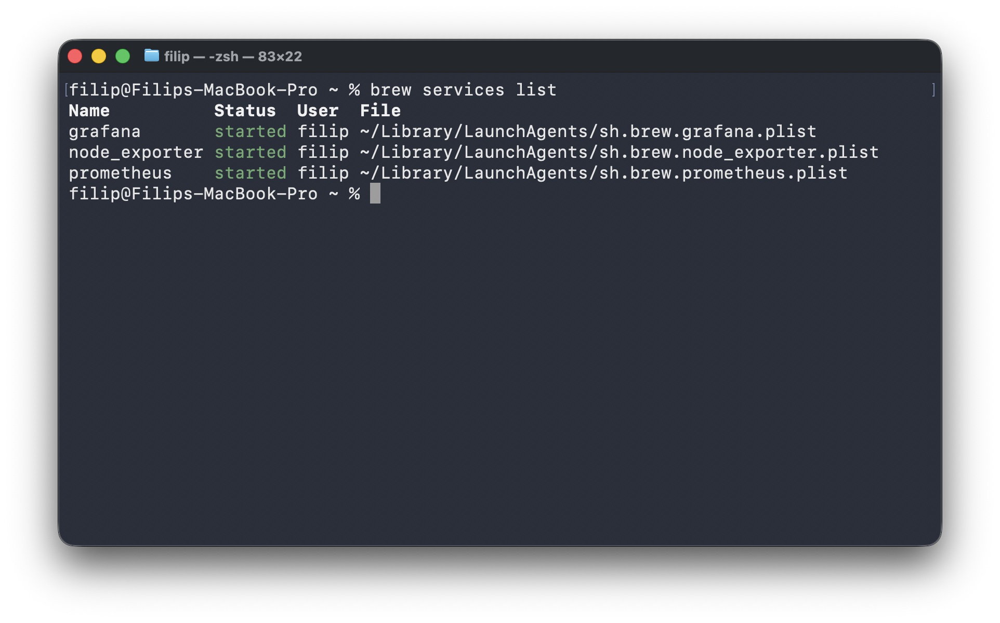

Prometheus needs to know which endpoints to collect metrics from. This is configured in a YAML file called `prometheus.yml`.

First, we need to find our Homebrew paths:

```sh
brew --prefix
cat "$(brew --prefix)/etc/prometheus.args"
```

Look for the `--config.file` line in the output; it tells you which configuration file Prometheus uses. The standard Homebrew setup uses a configuration under the Homebrew `etc` directory (`/opt/homebrew/etc/prometheus.yml`). That's the file we'll edit.

Edit the configuration file:

```sh
nano "$(brew --prefix)/etc/prometheus.yml"
```

Homebrew ships a default `prometheus.yml`, so replace its contents with the configuration below (if the file doesn't exist, create it):

```yml
global:
  scrape_interval: 15s

scrape_configs:
  - job_name: 'prometheus'
    static_configs:
      - targets: ['localhost:9090']

  - job_name: node
    static_configs:
      - targets: ['localhost:9100']
```

The `scrape_interval` determines how frequently Prometheus fetches metrics.

This configures two targets:

- `prometheus`: Prometheus monitors itself
- `node`: Prometheus collects metrics from Node Exporter

After saving the YAML file, double-check the file formatting by running the following command:

```sh
promtool check config "$(brew --prefix)/etc/prometheus.yml"
```

If everything's fine, you'll get:

```
Checking /opt/homebrew/etc/prometheus.yml
 SUCCESS: /opt/homebrew/etc/prometheus.yml is valid prometheus config file syntax
```

Finally, restart Prometheus:

```sh
brew services restart prometheus
```

### Prometheus GUI

Give it about 30 seconds to collect some metrics and open http://localhost:9090/query in your browser.

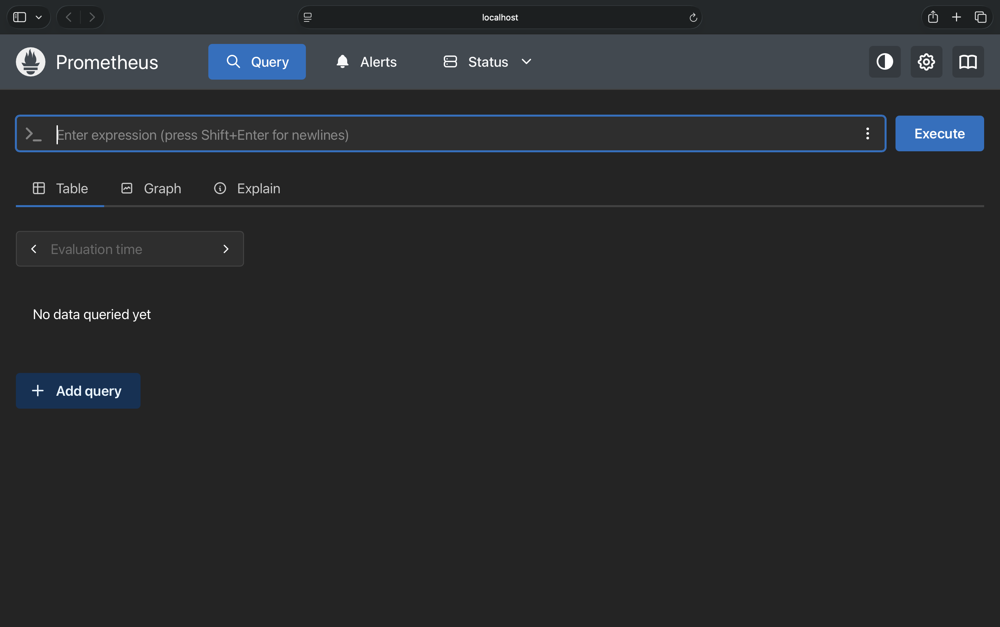

If we go into **Status** > **Target health**, both services should be up:

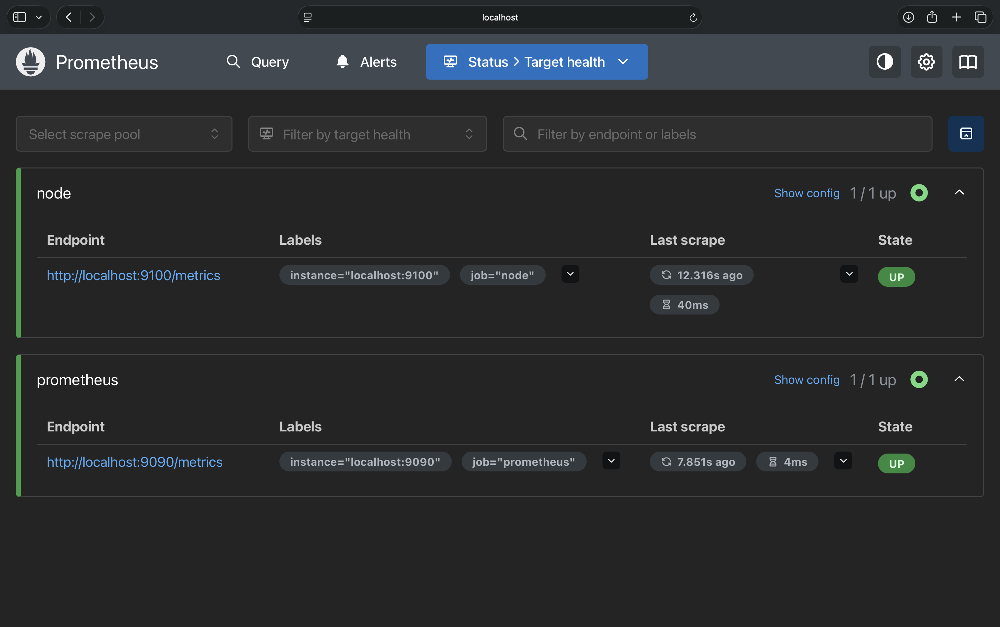

### PromQL

PromQL stands for Prometheus Query Language. It's the language you use to ask Prometheus questions about the metrics it has collected.

Enter `up` on the Query page and hit Execute. It returns 1 for each target Prometheus scraped successfully, and 0 when a scrape fails. You should see both of your targets.

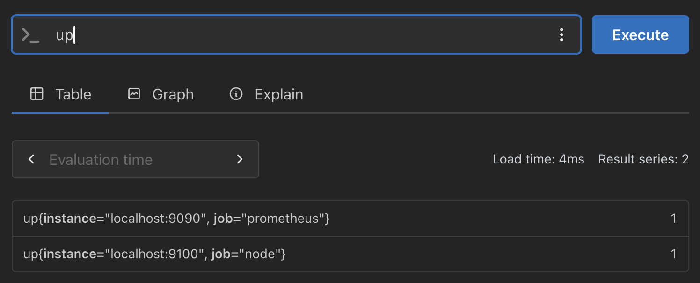

Now look at something more interesting: `node_cpu_seconds_total`. It returns a long list of numbers, one series per CPU core per mode (`idle`, `nice`, `system`, `user`):

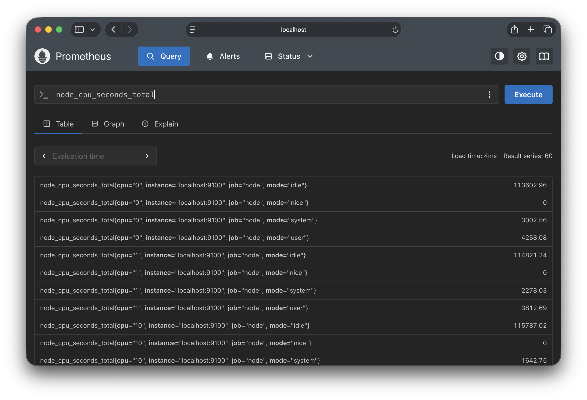

This metric, `node_cpu_seconds_total`, is a **counter**. A counter is like a car's odometer: it only goes up. Each core keeps a running total of the seconds it has spent idle, in user code, in system code and so on since the machine booted.

The odometer reading alone doesn't tell you much. What you want to know is how fast you're driving right now. For that, you compare two readings: how much the counter grew over a time window, divided by the length of the window. That is what `rate()` does. It turns "total seconds so far" into "seconds per second".

_A rule of thumb_: metric names ending in `_total` are counters and almost always need `rate()`. Metrics that go up and down, like free memory, are _gauges_ and are read directly. (This is a Prometheus metric type, unrelated to Grafana's Gauge visualization we'll use later.)

There are four building blocks when using PromQL:

- **Metric name:** `up` selects a metric called `up`.
- **Labels:** `up{job="node"}` filters the results to the Node Exporter job. `=` is an exact match, `!=` excludes a value, and `=~` matches a pattern.
- **Range and function:** `[5m]` takes the last five minutes of readings, and `rate(metric[5m])` turns a counter's growth over that window into a per-second rate.
- **Aggregation:** `avg by (instance)(...)` combines many series into fewer. `sum` works the same way, and you'll use it later for network traffic.

Here is the query we'll use for the CPU gauge:

```
100 * (1 - avg by (instance) (
  rate(node_cpu_seconds_total{mode="idle"}[5m])
))
```

It looks dense, so let's read it from the inside out:

- `node_cpu_seconds_total{mode="idle"}` is the idle-time counter, with one series per core.
- `[5m]` asks for the last five minutes of readings for each core.
- `rate(...)` converts each core's growth into seconds per second. A core can be idle at most 1 second per second, so each value is between 0 and 1. For example, 0.98 means the core was idle 98% of the time.
- `avg by (instance)(...)` averages across all cores, so you get one number for the whole machine instead of one line per core.
- `1 - ...` flips "fraction idle" into "fraction busy": 0.98 idle becomes 0.02 busy.
- `100 * ...` turns that into a percentage: 2%.

Why five minutes? It's a trade-off. A short window like `[1m]` reacts quickly but is noisy, and a long one like `[15m]` is smooth but slow to show spikes. Five minutes seems like a good middle ground, and it comfortably spans many scrapes at your 15-second interval.

Paste the query into the **Query** page, hit **Execute**, then switch to the **Graph** tab.

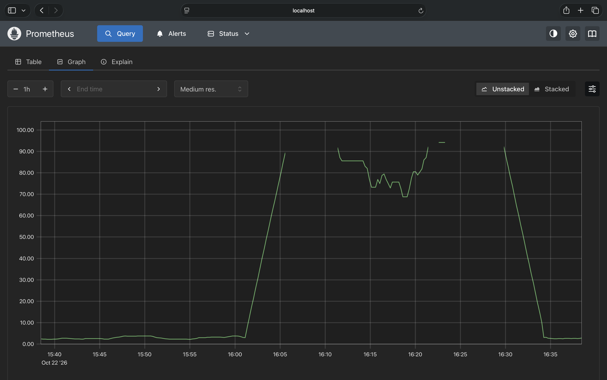

To learn more about PromQL, you can go over the official [Querying basics guide](https://prometheus.io/docs/prometheus/latest/querying/basics/).

Now you might be wondering why we need Grafana when Prometheus already has a graph view. Grafana becomes useful when you want to turn individual metrics into a proper monitoring dashboard. As I mentioned before, Grafana allows you to customize your dashboards to your liking and needs and includes countless features on top (including things like alert systems).

In short, Prometheus graphs help you investigate, while Grafana dashboards help you monitor.

## Creating Your First Grafana Dashboard

Go back to Grafana at http://localhost:3000. In the left sidebar, open **Connections** > **Data sources** > **Add data source**, then select **Prometheus**.

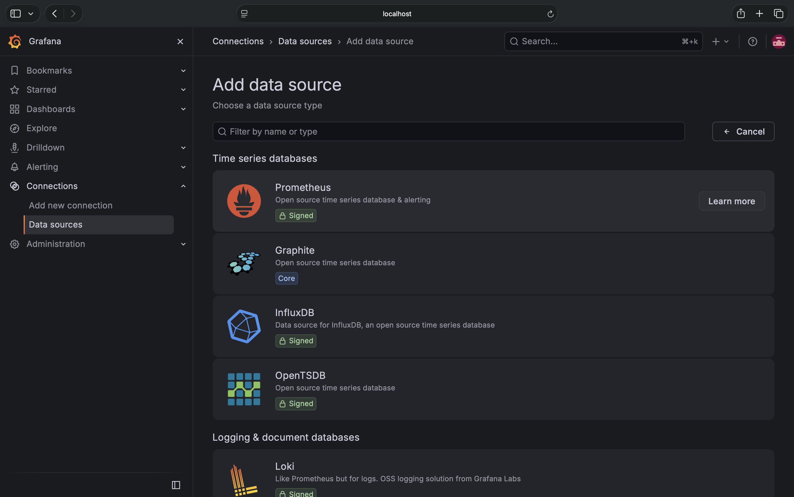

In the Prometheus connection settings, set the server URL to `http://localhost:9090`. Leave other settings at their defaults, then click **Save & test**. You should get a success message:

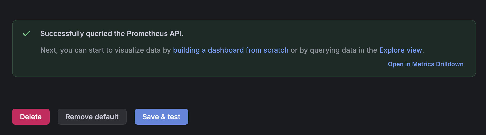

### Create your first CPU graph

Go to **Dashboards** > **Create dashboard**, then add a new panel.

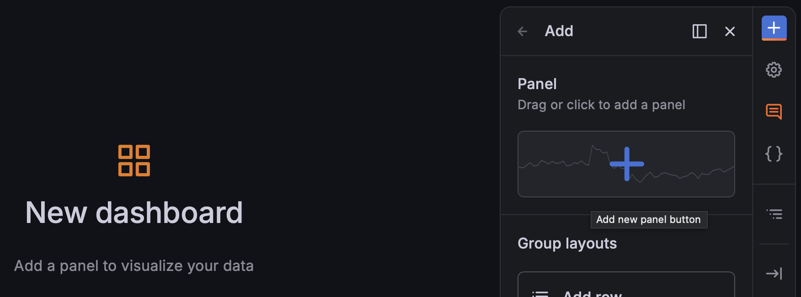

Click **Configure visualization** and select your Prometheus data source. In the query editor, switch the **Builder** / **Code** toggle to **Code** so you can type PromQL directly, then enter:

```
100 * (1 - avg by (instance) (
  rate(node_cpu_seconds_total{mode="idle"}[5m])
))
```

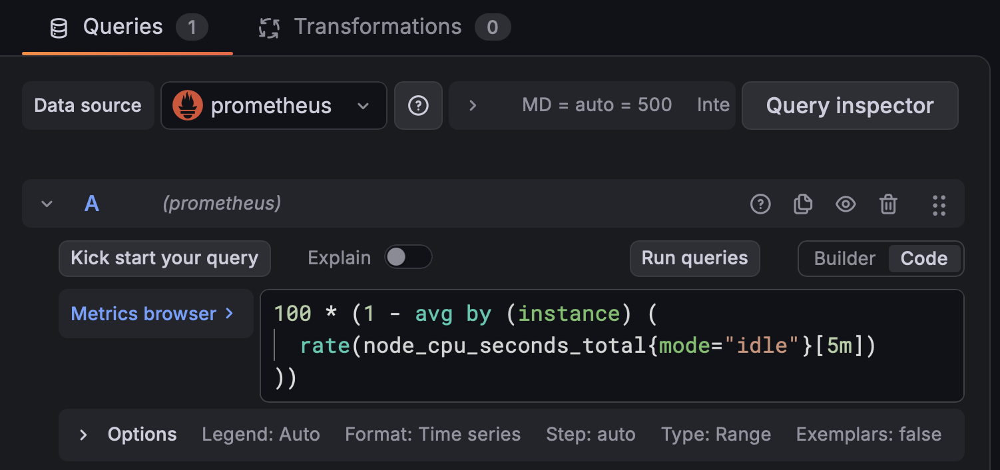

Hit **Run queries**, and you should see a graph like the one below.

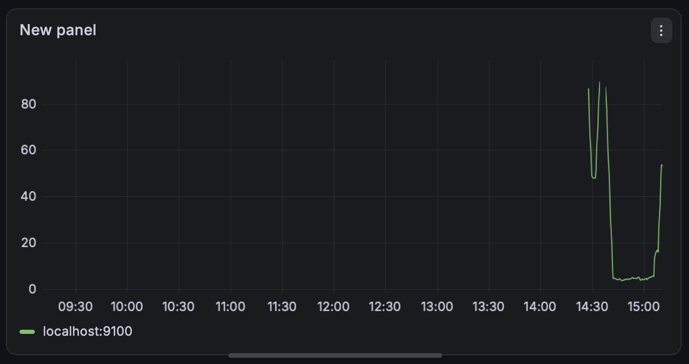

Now it's time to change the UI - I'd like to display it as a _gauge_.

In the right panel, search and select "Gauge" (either semi-circle or full circle).

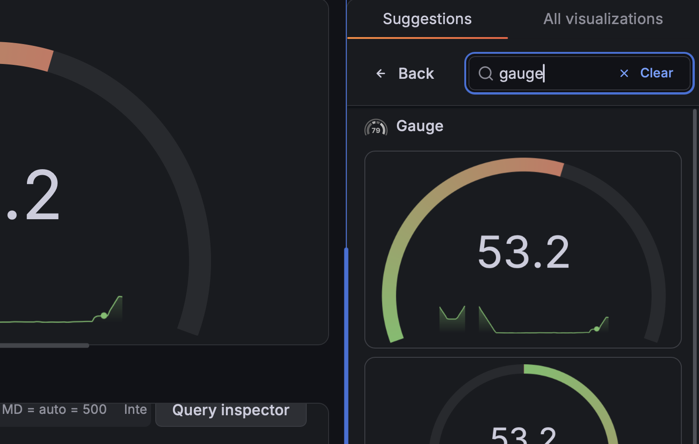

Set the title to "CPU Usage".

Next, we'll configure the display. In the same options pane on the right, under **Standard options**, set:

- Unit: Percent (0-100)
- Min: 0
- Max: 100

Under **Thresholds**, add steps so the gauge turns yellow above 70% and red above 90%. Grafana colors the gauge according to the highest threshold the current value has crossed.

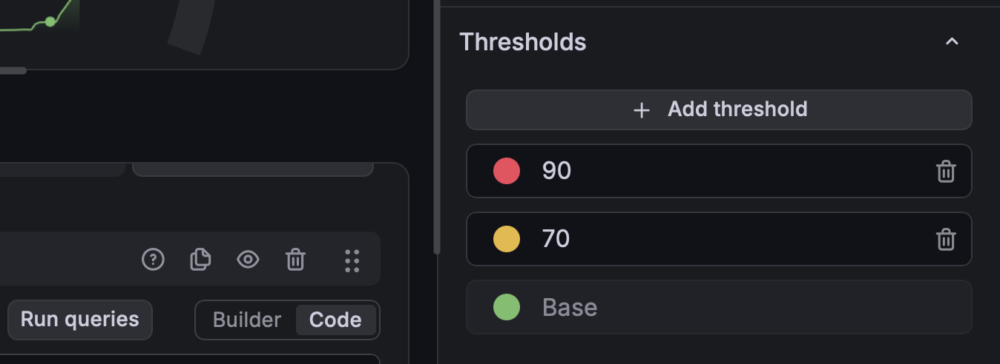

I'd recommend just playing around with the settings. You can customize pretty much any aspect of the interface (glow, width, bar style...).

When you're happy with your UI, click **Save**. You'll be asked to name your dashboard.

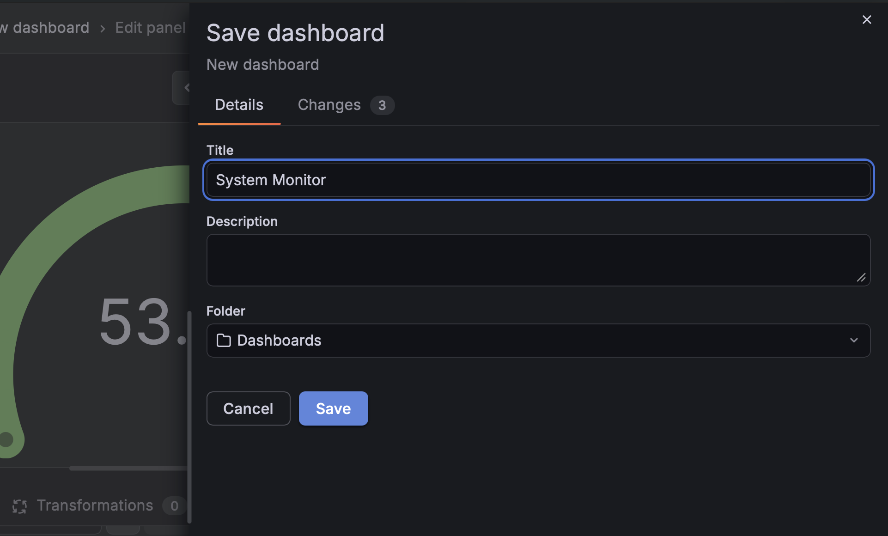

And just like that you've created your first Grafana dashboard with a panel.

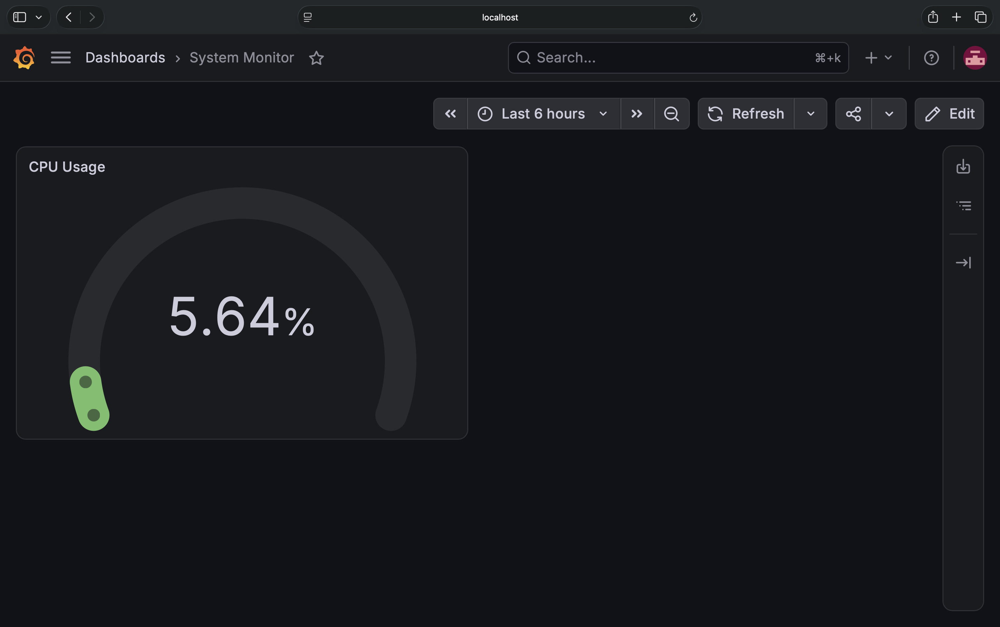

I've also added these two panels:

- Disk space used (bar gauge)
- Network traffic (time series)


For the disk space used I queried the following:

```
100 * (
  1 -
  node_filesystem_avail_bytes{mountpoint="/"}
  /
  node_filesystem_size_bytes{mountpoint="/"}
)
```

It gives the percentage of disk space used. The `mountpoint="/"` means "only the main volume", and it keeps external drives out of your gauge.

For the network traffic panel, I used two queries. To get the received traffic:

```
rate(node_network_receive_bytes_total{device="en0"}[5m])
```

And for the sent:

```
rate(node_network_transmit_bytes_total{device="en0"}[5m])
```

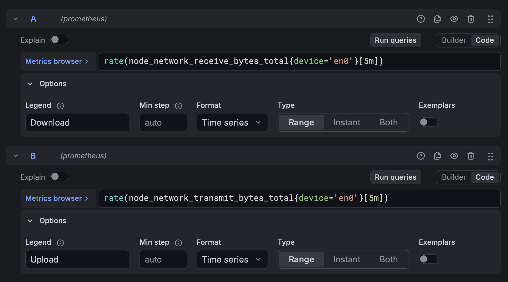

I chose `device="en0"`, the primary network interface. On most MacBooks this is Wi-Fi, but on desktop Macs with Ethernet it's usually the wired port. To see which interface is which on your Mac, run `networksetup -listallhardwareports`. Also, I set the units to bytes/sec.

## Clean Up

This section is optional. Follow it only if you want to remove everything you installed. If you keep the setup, Prometheus already deletes data older than about 15 days on its own.

First, stop the services and remove them from your login items:

```sh
brew services stop grafana prometheus node_exporter
```

Now, check again:

```sh
brew services list
```

You should see:

```
Name          Status User File
grafana       none
node_exporter none
prometheus    none
```

While Node Exporter doesn't store anything (it only serves live values), Prometheus keeps its scraped samples in a local time-series database on your Mac. To find the database, run:

```sh
cat "$(brew --prefix)/etc/prometheus.args"
```

Look for the `--storage.tsdb.path` line. In my case that is `--storage.tsdb.path /opt/homebrew/var/prometheus`, so I'd run:

```sh
rm -rf "$(brew --prefix)/var/prometheus"/*
```

To uninstall everything, run:

```sh
brew uninstall grafana prometheus node_exporter
```

You may get something like:

```
Warning: The following grafana configuration files have not been removed!
If desired, remove them manually with `rm -rf`:
  /opt/homebrew/etc/grafana
  /opt/homebrew/etc/grafana/grafana.ini
  /opt/homebrew/etc/grafana/grafana.ini.example
```

Homebrew leaves more behind than this warning lists: Grafana's database (your dashboards, users and password) and logs, the Prometheus data directory, and the Prometheus and Node Exporter config files, including the `prometheus.yml` we edited earlier. To remove them all, run:

```sh
rm -rf "$(brew --prefix)/etc/grafana" \
  "$(brew --prefix)/var/lib/grafana" \
  "$(brew --prefix)/var/log/grafana" \
  "$(brew --prefix)/var/prometheus" \
  "$(brew --prefix)/etc/prometheus.yml" \
  "$(brew --prefix)/etc/prometheus.args" \
  "$(brew --prefix)/etc/node_exporter.args"
```

Check the paths first, as they can vary by version.

## Conclusion

We've just set up Grafana with Prometheus to monitor your Mac's metrics.

To quickly recap, this is how the data flows:

- **Your Mac**: Node Exporter exposes your machine's metrics on port 9100
- **Prometheus**: Scrapes and stores the metrics, while exposing them on port 9090
- **Grafana**: Queries Prometheus and displays dashboards (running on port 3000)

The same three-step pattern (expose, collect, visualize) scales from a laptop to a fleet of servers. Only the exporters and the dashboards change.

Here are a couple of suggestions for where to go from here:

- **Add a memory panel**: memory is the natural fourth panel (`node_memory_free_bytes` is the amount of RAM that is unused right now)
- **Import a community dashboard**: in Grafana, go to **Dashboards** > **New** > **Import dashboard** and enter ID `1860` (Node Exporter Full; it's Linux-based, so some queries aren't available on Mac)
- **Try alerting:** create an alert that fires when CPU stays above 90% for five minutes
- **Monitor something else**: Prometheus has exporters for databases, web servers and containers. You can also take advantage of countless plugins, such as the Strava plugin for runners.

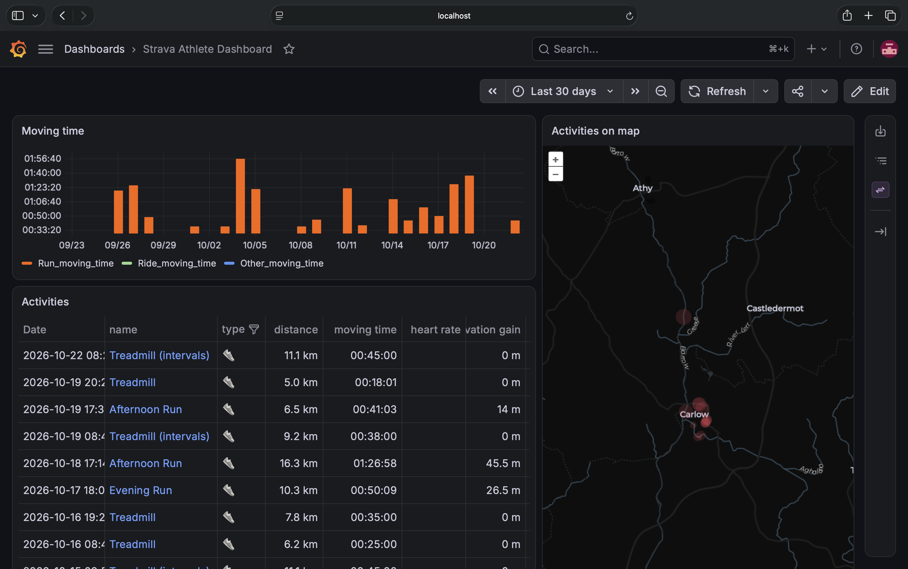

Happy monitoring.
